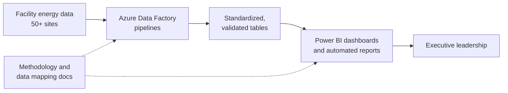

# TQL Energy and Emissions Reporting: case study

From January to May 2026 I was Project Lead on a Net Impact Consulting engagement at the University of Cincinnati for Total Quality Logistics (TQL). The goal was to give TQL's executive leadership one trusted view of energy use and emissions across more than 50 facilities.

This repo describes the approach and results. Client data and pipeline definitions are not published.

## Results

| Measure | Result |
|---|---|
| Facilities covered | 50+ |
| Manual processing time | cut by 85% |
| Data consistency | improved by 92% |
| Audience | executive leadership |

## The problem

Energy and emissions data arrived from each facility in different shapes and was combined by hand in Excel. That was slow, and the same metric could mean slightly different things depending on who prepared it.

## The approach

1. **Pipelines instead of spreadsheets.** I built Azure Data Factory pipelines that ingest each facility's data, and map it to one standard set of fields.
2. **One set of definitions.** I documented the methodology and every data mapping, so each KPI on a dashboard traces back to its source fields.
3. **Dashboards leadership can use.** Power BI dashboards and automated reports track energy and emissions KPIs across all facilities.
4. **Faster building.** I used Copilot and Power Platform to speed up report building and documentation.

## What I learned

- Most of the work in a reporting project is agreeing on definitions. The pipeline is easy once everyone agrees what a number means.
- Writing down data mappings is what makes a dashboard trustworthy. When a figure looks off, the mapping document tells you where to look.
- Automating the boring merge step is where the time savings came from, not from the dashboards themselves.

## Tools

Azure Data Factory, Power BI, Power Platform, Copilot, Excel

## Contact

Sumit Kashid · [sumit-kashid.github.io](https://sumit-kashid.github.io) · [LinkedIn](https://www.linkedin.com/in/sumit-kashid/) · sumitkashid505@gmail.com
